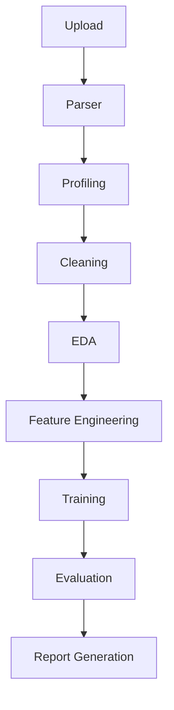

# New Linear Pipeline Architecture

## The 9-Stage Execution Graph

The new pipeline is defined in a strict, linear order, orchestrated through a background thread in `core/api/v1/routes_data.py`. 

## Stage Descriptions

1. **Upload (`UploadAgent`)**:
   - Validates that the initially uploaded file exists securely on the temp directory. Acts as the gateway entry point for the rest of the execution flow.

2. **Parser (`ParserAgent`)**:
   - Loads the dataset via Pandas (`read_csv` or `read_excel`) into memory.
   - Pushes the initial parsed dataframe directly into the persistent data service storage so subsequent agents can retrieve it.

3. **Profiling (`ProfilingAgent`)**:
   - Reads the dataframe and computes initial dataset dimensions (rows, cols) and total missing values, representing the core metadata profile and summary.

4. **Cleaning (`CleaningAgent`)**:
   - Isolates numeric and categorical columns.
   - Fills null numeric values using the column median and fills categorical nulls via the mode. Updates the dataset stored in the system.

5. **EDA (`EDAAgent`)**:
   - Extracts all mathematical features and performs Pearson correlation analysis.
   - Returns dict representations of correlations safely.

6. **Feature Engineering (`FeatureEngineeringAgent`)**:
   - Performs automated One-Hot Encoding via Pandas `get_dummies` on low-cardinality categorical variables, making the dataset ready for modeling.
   - Restores the fully processed dataset back into storage.

7. **Training (`TrainingAgent`)**:
   - Selects the target column for training. Represents the hook where Sci-kit or custom ML logic takes over to build models against the cleanly preprocessed dataframe.

8. **Evaluation (`EvaluationAgent`)**:
   - Simulates returning key evaluation metrics (Accuracy, F1-Scores) to measure model effectiveness.

9. **Report (`ReportAgent`)**:
   - Concludes execution, wraps all accumulated insights, datasets, and models, and outputs a downloadable reference URI for the user report.

## Error Handling Mechanism
The job manager loops over stages sequentially. Should any agent throw an `Exception` (e.g. data is unparseable), the orchestrator intercepts it. It automatically serializes the explicit stack trace (`traceback`), error name, and suggests diagnostics via the `root_cause` attribute of the job, preventing silent failures and alerting UI consumers via status `FAILED`.
